# Home SOC SIEM Lab: Splunk Enterprise with Linux and Windows Log Collection

A small home lab where I built a SIEM from scratch, collected logs from a Linux server and a Windows 11 machine, simulated failed logins against my own systems, and wrote detections, an alert and a dashboard for them.

This is a follow-up to my [Home IT & Network Lab](https://github.com/Melsakhawy/home-it-network-lab), which covers the Tailscale network, firewalls and Wireshark work this lab runs on.

> All attacks in this lab were simulated by me, from my own Windows VM, against my own Ubuntu VM. Nothing here touches anyone else's systems.

## Skills demonstrated

- Installing and configuring Splunk Enterprise on Linux, including running it as a non-root user
- Ingesting log files (Linux) and Windows Event Logs (Universal Forwarder) into one index
- Writing SPL searches with `rex`, `stats`, `eval` and `mvindex`
- Building a scheduled alert with a threshold and severity
- Building a dashboard from saved searches
- Firewall rules (UFW) to limit the Splunk receiving port to one host
- Troubleshooting file permissions, disk space and log parsing problems

## Architecture

```
Windows 11 Home VM                         Ubuntu VM
+---------------------------+              +-------------------------------------+
| Splunk Universal Forwarder|   TCP 9997   | Splunk Enterprise 10.6.0.5          |
| - Security log            | -----------> | - Receiving port 9997               |
| - System log              |  (Tailscale) | - Monitors /var/log/auth.log        |
+---------------------------+              | - Monitors /var/log/ufw.log         |
                                           | - UFW: 9997 allowed from Windows VM |
                                           +-------------------------------------+
```

Both VMs run in VirtualBox and talk to each other over Tailscale. Tailscale addresses are shown as `<UBUNTU_TAILSCALE_IP>` and `<WINDOWS_TAILSCALE_IP>` in this write-up.

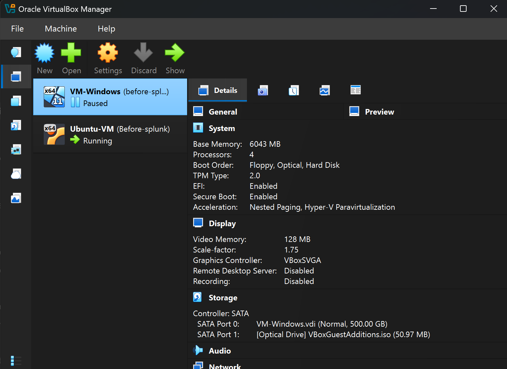

## Part 1: Splunk on Ubuntu

I installed Splunk Enterprise 10.6.0.5 from the `.deb` package. Splunk refuses to start as root, so it runs as a dedicated `splunk` user.

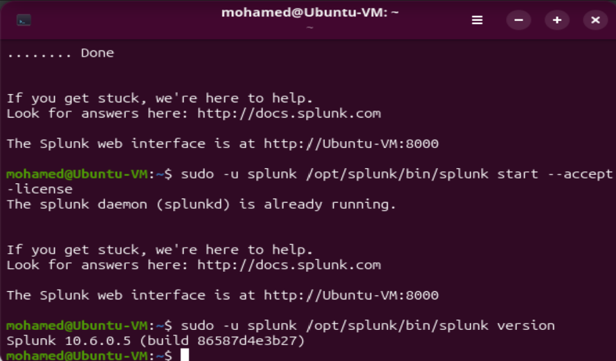
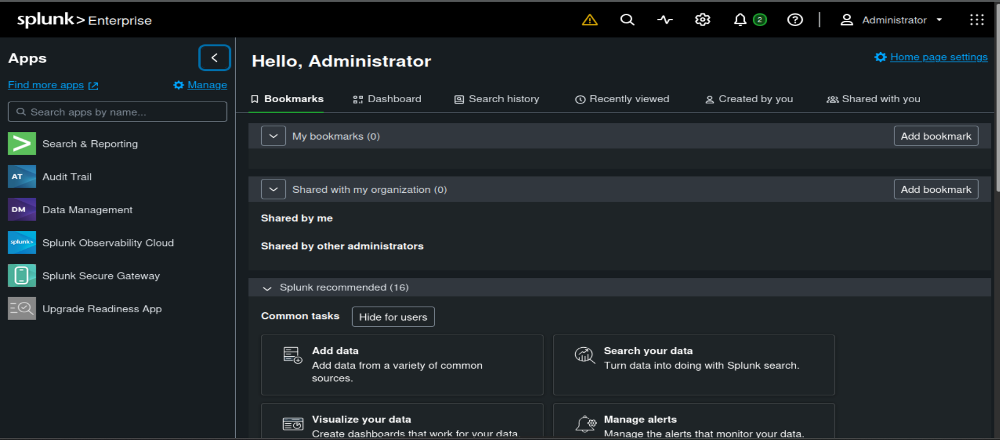

### Startup warnings

Splunk showed two warnings after starting:

1. **Minimum free disk space (5000 MB) reached.** My VM disk was small, and VirtualBox cannot resize a disk that has snapshots. As a lab-only workaround I lowered the threshold to 2000 MB in `server.conf`. I would not do this in production.
2. **Empty `allowedDomainList`.** This only matters for email alert actions. I did not configure any email actions, so I left it alone. In a real deployment I would restrict it to approved domains.

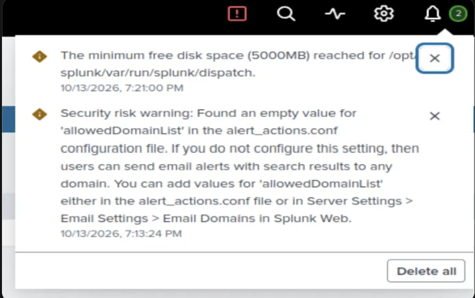
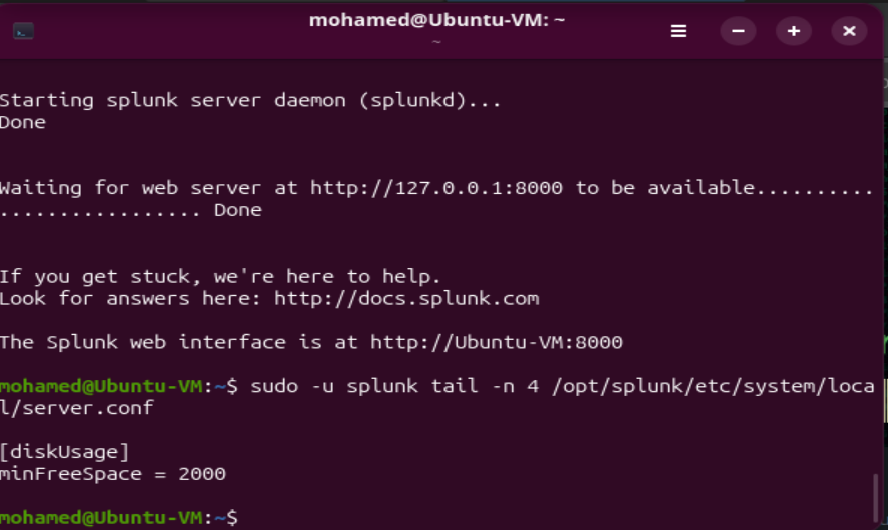

### Receiving port

I enabled receiving on TCP 9997 and confirmed `splunkd` was listening on it.

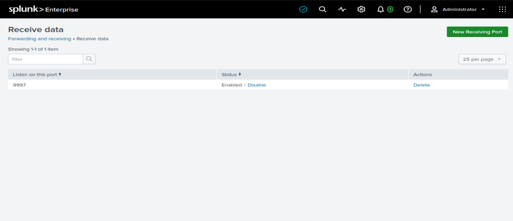
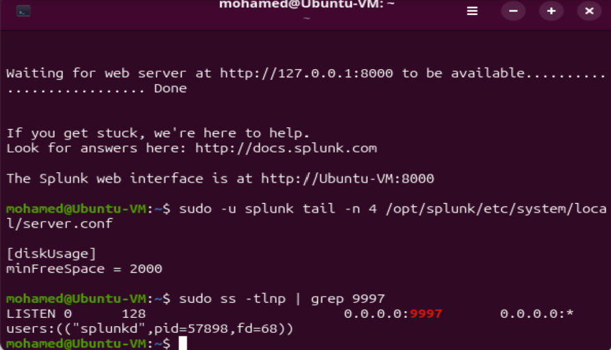

### Firewall

UFW is active. The rule for port 9997 only allows the Windows VM's Tailscale address, so no other host can send data to Splunk.

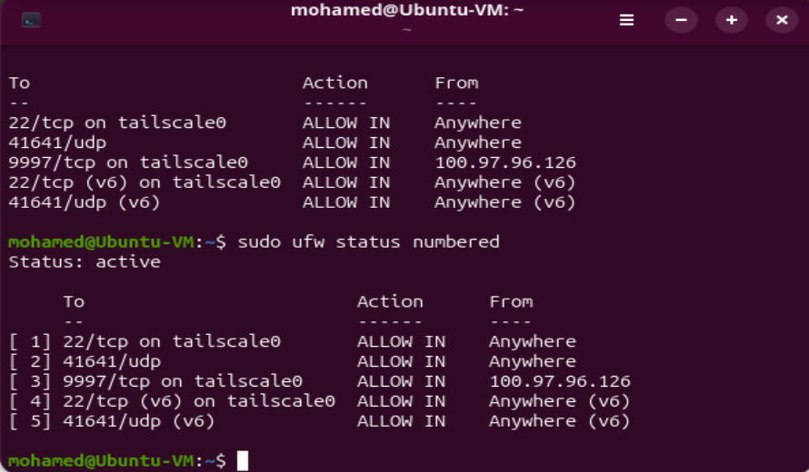

Note: Tailscale handles tailnet traffic in its own firewall chain, so UFW rules for tailnet traffic document intent, and tailnet membership is the real control. I found this in my earlier lab.

### Collecting the Ubuntu logs

`/var/log/auth.log` and `/var/log/ufw.log` are owned by `syslog:adm` with mode 640. The `splunk` user could not read them, so I added it to the `adm` group and restarted Splunk, rather than loosening the file permissions.

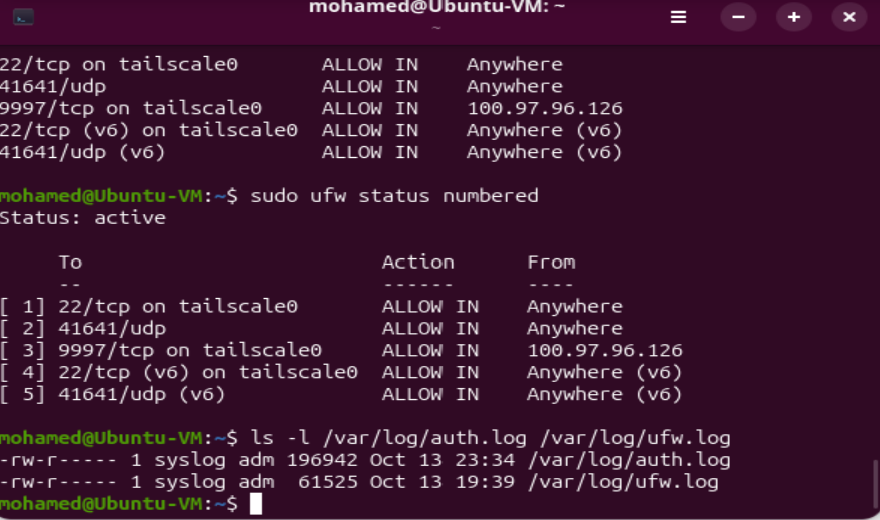
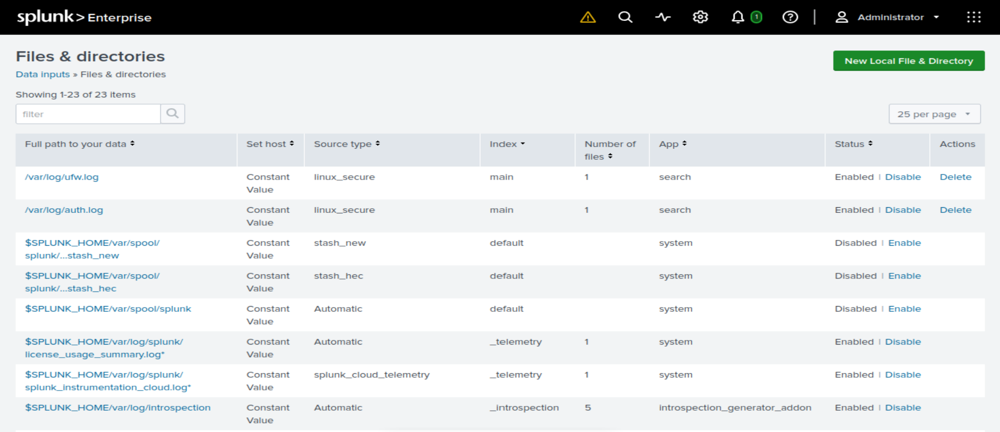

Both files were indexed into `main`. In the last 24 hours, `auth.log` contributed 155 events and `ufw.log` 33.

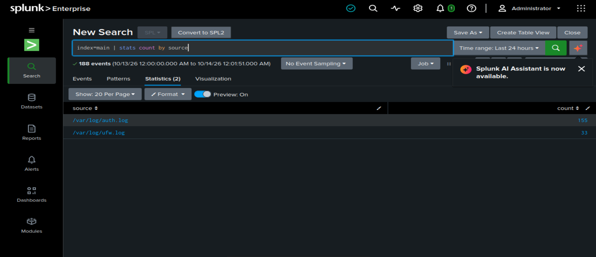

## Part 2: Detecting failed SSH logins

SSH on the Ubuntu VM only accepts public keys, so I expected failed attempts to look different from the usual "Failed password" lines. I checked the real log format before writing a detection.

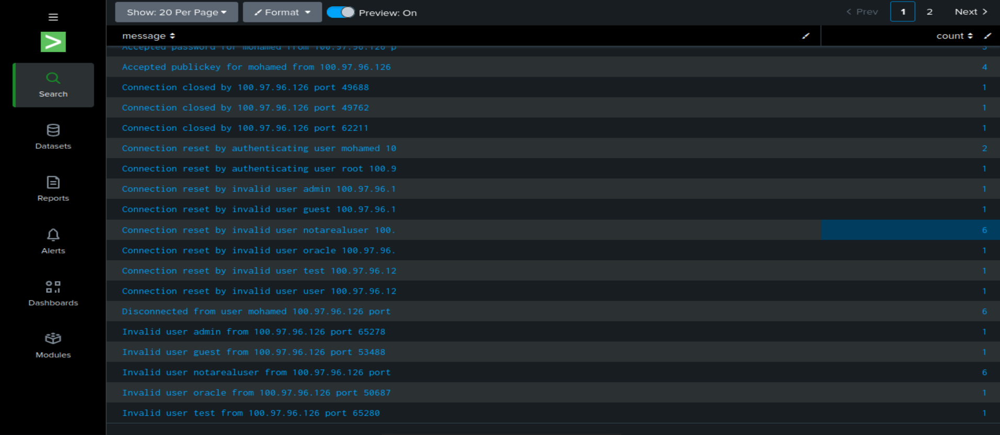

To generate test data, I tried to SSH from my Windows VM to the Ubuntu VM using usernames that do not exist (`notarealuser`, `admin`, `guest`, `oracle`, `test`, `user`). The server refused each attempt with `Permission denied (publickey)` and logged `Invalid user <name> from <WINDOWS_TAILSCALE_IP> port <port>`.

### Detection search

```spl
index=main source="/var/log/auth.log" "Invalid user"
| rex "Invalid user (?<attempted_user>\S+) from (?<src_ip>\d+\.\d+\.\d+\.\d+)"
| stats count by src_ip, attempted_user
| sort - count
```

Result: 11 invalid-user events from one source, covering six different usernames.

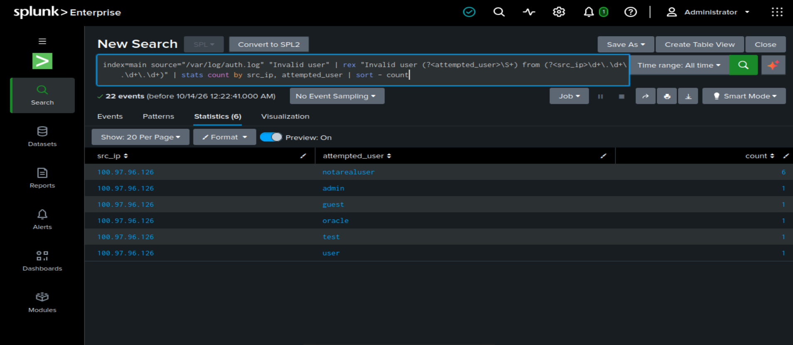

## Part 3: Alert

I turned the search into a scheduled alert that looks for one source trying five or more invalid usernames within an hour:

```spl
index=main source="/var/log/auth.log" "Invalid user"
| rex "Invalid user (?<attempted_user>\S+) from (?<src_ip>\d+\.\d+\.\d+\.\d+)"
| stats count, dc(attempted_user) as usernames_tried by src_ip
| where count>=5
```

| Setting | Value |
| --- | --- |
| Name | SSH brute force - 5+ invalid users |
| Type | Scheduled, hourly, at 0 minutes past the hour |
| Time range | Last 60 minutes |
| Trigger | Number of results greater than 0, once |
| Action | Add to Triggered Alerts |
| Severity | Medium |

**Why Medium:** five or more invalid usernames from one address is suspicious, but every attempt was refused and the server only allows keys, so nothing was compromised. A successful login from the same address after failures would be a separate, higher-severity detection.

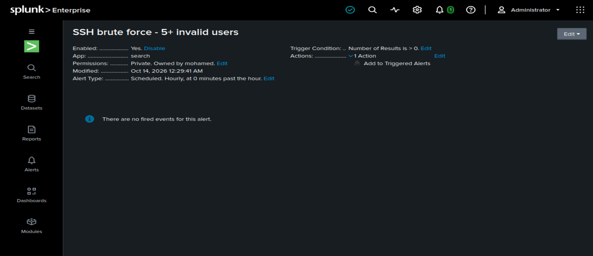
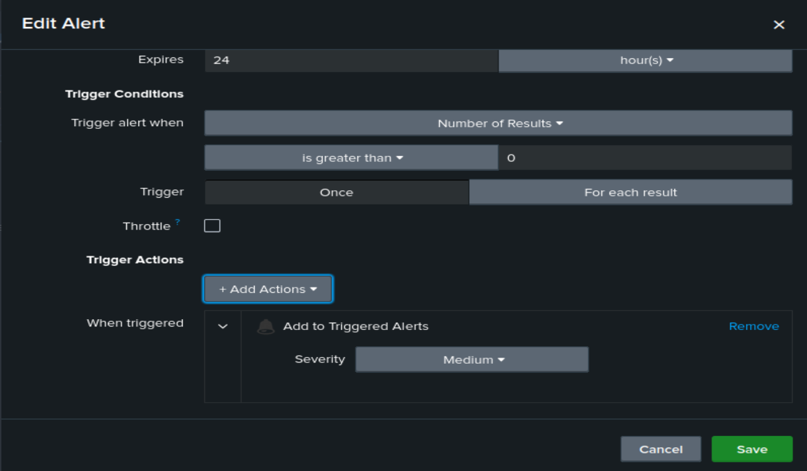

The alert fired at 01:00:00 BST on 14 October 2026, on its first scheduled run after the simulated attempts.

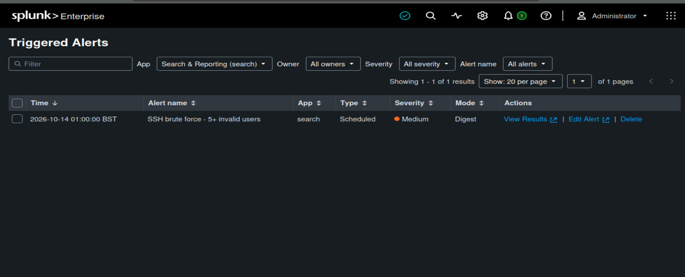
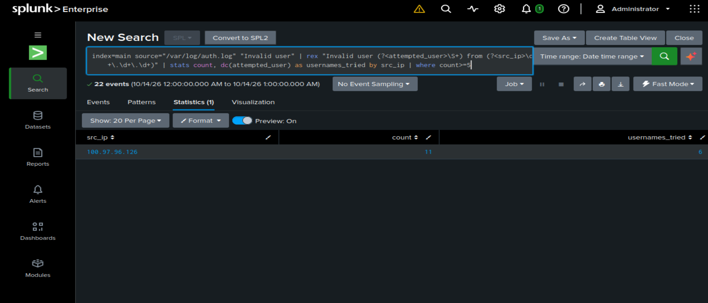

## Part 4: Windows logs with the Universal Forwarder

I installed the Splunk Universal Forwarder on the Windows 11 Home VM. During installation I selected only the **Security** and **System** event logs, and left Application, performance monitoring and Active Directory monitoring unticked. The VM is a standalone machine, not a domain controller.

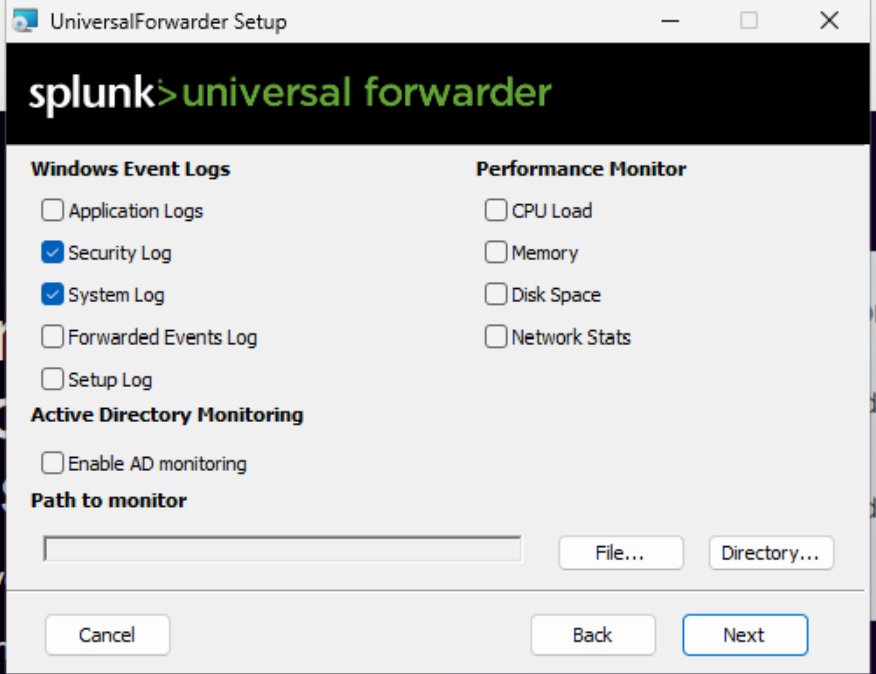

The installer wrote the receiving server into `outputs.conf`:

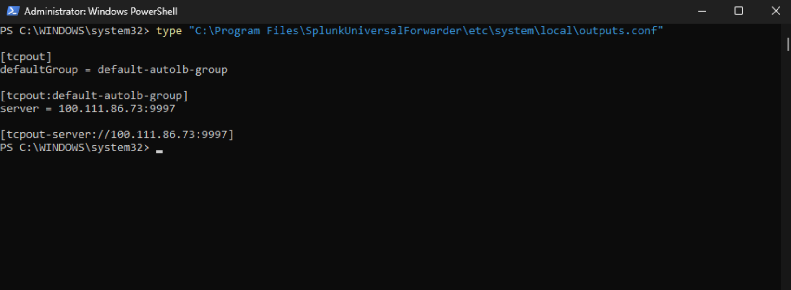

Splunk then received events from both Windows logs:

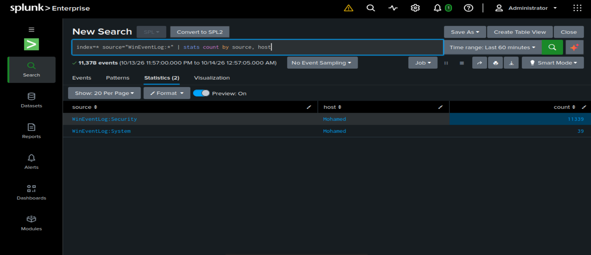

### Windows failed logons (Event ID 4625)

I generated failed logons on my own VM using fake account names. I then searched for Event ID 4625:

```spl
index=* source="WinEventLog:Security" EventCode=4625
| eval target_user=mvindex(Account_Name,-1)
| stats count by host, target_user
```

Results:

- Five fake accounts, one attempt each: `admin`, `backup`, `fakeadmin`, `guest`, `test`.
- Four more events with a blank (`-`) target account. I investigated these: all four were logon type 2 (interactive), a few seconds apart, and matched my own incorrect PIN entries at the console. The log itself does not name the process, so I identified them from the logon type, the timing and knowing what I had done.

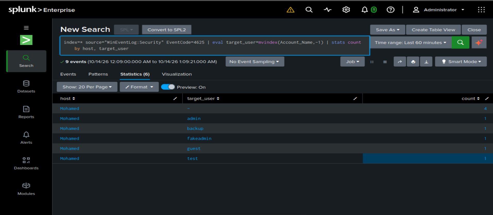

## Dashboard

I saved four searches into one dashboard, **Home SOC Overview**:

1. Failed SSH logins by source IP
2. Usernames tried over SSH
3. Windows failed logons (4625) by account
4. UFW blocks by destination port

```spl
index=main source="/var/log/ufw.log" "UFW BLOCK"
| rex "DPT=(?<dest_port>\d+)"
| stats count by dest_port
| sort - count
```

The UFW panel shows blocked traffic that I did not generate myself, mostly to ports 3702 and 5353. Those ports are commonly associated with WS-Discovery and mDNS, which is routine device-discovery traffic, but I have not investigated them further.

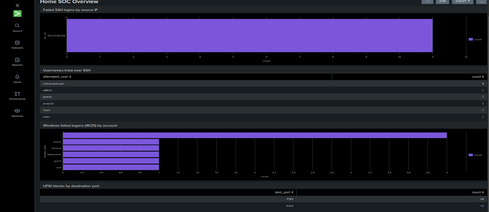

## Problems I ran into and how I fixed them

| Problem | Cause | Fix |
| --- | --- | --- |
| Downloaded the wrong installer | Took the Windows `.msi` instead of the Linux `.deb` | Copied the download link from the Linux tab |
| Splunk would not start | It refuses to run as root | Ran it as a dedicated `splunk` user and fixed ownership of `/opt/splunk` |
| Splunk could not read logs | `auth.log` and `ufw.log` are `syslog:adm`, mode 640 | Added `splunk` to the `adm` group |
| Low disk space warning | Small VM disk, with snapshots preventing a resize | Removed the installer package, then lowered `minFreeSpace` to 2000 MB (lab only) |
| SSH detection showed no new rows | My regex looked for `sshd[1234]:`, but OpenSSH writes per-connection lines as `sshd-session[1234]:`, so those events were silently dropped from the table | Changed the regex to `sshd(-session)?\[\d+\]:`. I noticed because the event count (69) did not match the sum of the table (16). |
| Windows failed-logon table looked wrong | `Account_Name` holds two values (subject and target) | Used `mvindex(Account_Name,-1)` to keep the target account |

## Limitations

- The "attacker" is my own VM, from a single source address, so the data is small and simulated.
- The alert is scheduled, and Splunk warns that scheduled searches stop running once the Enterprise trial licence expires.
- I lowered Splunk's minimum free disk threshold as a lab workaround.
- `ufw.log` was indexed with the `linux_secure` source type, so UFW fields are not extracted automatically and I used `rex`.
- The Windows VM is standalone. There is no Active Directory.
- Tailscale addresses are visible in some screenshots. They are private tailnet addresses.

## Next steps

- Add a Windows Server domain controller and monitor Active Directory authentication events
- Add a detection for a successful login (4624 or `Accepted publickey`) after repeated failures from the same source
- Add Sysmon on the Windows VM for process and network events
- Map the detections to MITRE ATT&CK (for example T1110, Brute Force)
- Move to a free licence or a longer-lived setup so scheduled alerts keep running

## Tools

Splunk Enterprise 10.6.0.5, Splunk Universal Forwarder, Ubuntu (VirtualBox), Windows 11 Home (VirtualBox), Tailscale, UFW, OpenSSH, PowerShell.
